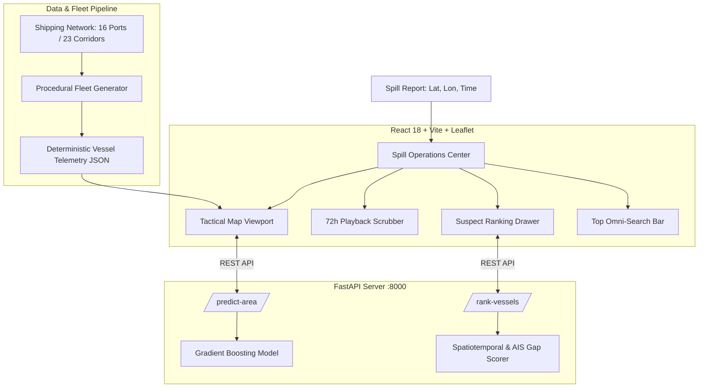

# OCEANTRACE

### AI-Powered Maritime Oil-Spill Attribution & Incident Intelligence Platform

> **Hackathon Prototype**: Built for marine operations centers, environmental protection agencies, and coast guard authorities to correlate oil spill incidents with historical AIS vessel telemetry and AI-predicted slick dispersion.

---

## Executive Summary (For Judges & Evaluators)

When an offshore oil spill or illegal bilge discharge occurs in international waters, identifying the responsible vessel has historically been a slow, fragmented process. By the time satellite imagery or patrol aircraft spot the slick, ocean currents and winds have already moved and dispersed the oil across dozens of square kilometers—and the offending vessel has already sailed away, often having turned off its AIS transponder ("gone dark") during the discharge.

**OCEANTRACE solves this attribution problem.** It provides an interactive, MarineTraffic-grade maritime operations command center that:
1. **Forecasts Slick Growth & Drift:** Combines hydrodynamic physics with an empirical machine learning model (Gradient Boosting) to predict slick expansion over a 72-hour window.
2. **Identifies Suspect Vessels:** Ranks vessels in the area based on spatial proximity, passage timing, and deliberate transponder blackouts (AIS gaps).
3. **Equips Decision-Makers:** Gives investigators transparent, explainable scoring metrics (no black-box guessing) to take immediate regulatory or legal action.

---

## Why OCEANTRACE Matters to Judges

| Evaluator Criterion | How OCEANTRACE Delivers |
| :--- | :--- |
| **Real-World Impact** | Solves illegal bilge cleaning ("magic pipe" dumping) and accidental crude tanker leaks by bridging satellite observation with historical AIS playback. |
| **Transparent & Explainable AI** | Avoids unverified black-box predictions. Every suspect attribution score is clearly broken down into mathematical sub-components: **Proximity Score**, **Time-Delta Score**, and **AIS Transponder Gap Penalty**. |
| **MarineTraffic-Grade UX** | A modern, high-density dark/light tactical map with nautical coordinate HUDs (Degrees + Decimal Minutes), directional vessel arrows, slide-out AIS telemetry drawers, and timeline scrubbers. |
| **Fail-Safe Offline Architecture** | If the backend ML service is offline or restarting, the UI seamlessly engages a client-side heuristic fallback so operations commanders never experience empty screens or UI crashes. |
| **Zero External API Cost** | 100% self-contained. Runs without requiring paid Mapbox, Google Maps, or MarineTraffic subscriptions—utilizing open GIS basemaps and deterministic procedural fleet generation. |

---

## Key Features & Capabilities

### 1. Dual-Engine Spill Footprint & Dispersion Modeling
* **Hydrodynamic Physics Engine:** Simulates surface oil transport vector based on prevailing wind vectors (3% windage rule) and ocean current velocity.
* **ML Area Regressor (FastAPI + Scikit-Learn):** A gradient-boosted regression model trained to predict volumetric slick spread ($km^2$) from initial volume, wind force, current speeds, and elapsed time ($T+0\text{ h}$ to $T+72\text{ h}$).

### 2. Automated Suspect Vessel Attribution Engine
* Evaluates all maritime traffic passing through the incident sector.
* **AIS Transponder Anomaly Detection:** Flags vessels that turned off their transmitters within 50 km of the slick origin near the time of discharge.
* **Scored Ranking:** Assigns a confidence score ($0.00$ to $1.00$) and categorizes suspects as **High**, **Medium**, or **Low** probability leads.

### 3. Tactical Maritime Operations Interface
* **Interactive 72-Hour Timeline Scrubber:** Replay past ship positions hour-by-hour to visualize which vessels intersected the spill origin at the estimated moment of discharge.
* **Dense Shipping Fleet & Fairways:** Populated with 35+ realistic Arabian Sea / Mumbai High vessels plus an extensible network of **16 major Indian Ocean seaports** and **23 international shipping corridors**.
* **Omni-Search Bar:** Search any vessel instantly by **Name**, **IMO Number**, **MMSI**, or jump straight to specific **Latitude/Longitude coordinates**.
* **Tactical Map Controls:** Switch between Clean Marine Light, Dark Navy, Satellite, and OpenStreetMap basemaps, toggle 5km/15km/30km incident range rings, and display coordinate grids.

---

## 30-Second Demo Walkthrough for Judges

1. **Launch App:** Open `http://localhost:5173`. Notice the clean maritime interface populated with real vessels (`MT Desh Shanti`, `Ever Given`, `CMA CGM Mumbai`, `DHT Lotus`).
2. **Observe the Spill Site:** The orange polygon in the Arabian Sea depicts the spill footprint. Adjust the **Wind Speed** or **Ocean Current** sliders in the left panel to watch the predicted area and drift vector update dynamically.
3. **Replay Historical Telemetry:** Press **Play** on the bottom timeline bar. Watch the vessels advance along their transit corridors from $T+0\text{ h}$ to $T+72\text{ h}$.
4. **Inspect Ranked Suspects:** Click the **Leads** tab on the left drawer. 
   - Notice **`MT Front Altair`** ranked as the **#1 High Suspect Lead**.
   - Click its card to see the breakdown: Closest approach of $6.0\text{ km}$, combined with a **$3.0\text{ h}$ AIS blackout** right at the estimated spill time.
5. **Inspect Vessel Telemetry:** Click any vessel on the map to open the **Vessel Detail Drawer**, showing real-world flags, draft, speed over ground (SOG), course over ground (COG), and reported destination.

---

## System Architecture

---

## Technical Highlights

* **Frontend:** React 18, Vite, Leaflet, React-Leaflet, Native CSS Design System (no heavy external UI framework bloat).
* **Backend:** FastAPI, Python 3.10+, Uvicorn, Scikit-Learn, Joblib, NumPy, Pandas.
* **Mathematical Heuristics:** Haversine great-circle distance formulas, exponential decay proximity scoring, and forward-backward linear trajectory interpolation.
* **Integration Ready:** Includes documented Gemma 4 / LLM incident report generation architecture (`docs/GEMMA_INTEGRATION.md`) and standardized REST contract (`docs/API.md`).

---

## Disclaimer

*OCEANTRACE is a prototype research demonstration created for hackathon and technology evaluation purposes. Datasets, routes, and vessel tracks utilize synthetic and simulated AIS telemetry to showcase operational feasibility without compromising confidential maritime surveillance feeds.*
